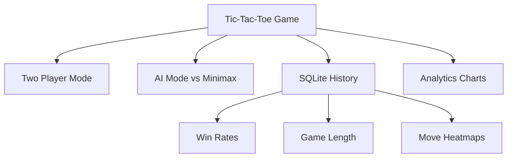

# 🎮 Tic-Tac-Toe Enhanced

<div align="center">


**Console Tic-Tac-Toe with SQLite History, Minimax AI & Analytics**

[]()
[](https://github.com/samalarakshithbabu/tic-tac-toe-enhanced/issues)

</div>

---

## 🚀 Executive Summary

A **console-based Tic-Tac-Toe game** featuring SQLite game history persistence, unbeatable Minimax AI opponent, and matplotlib analytics visualizations. Demonstrates game state management, adversarial search, and data visualization.

### What It Does



---

## ✨ Key Features

| Feature | Description |
|---------|-------------|
| **Two-Player Mode** | Human vs Human on console |
| **Minimax AI** | Unbeatable opponent with alpha-beta pruning |
| **SQLite History** | Persist all games to database |
| **Analytics Charts** | Matplotlib visualizations |

---

## 📊 Analytics Visualizations

| Chart | Description |
|-------|-------------|
| **Win Rate Comparison** | X wins vs O wins vs Draws |
| **Game Length Distribution** | Histogram of moves per game |
| **Opening Move Heatmap** | First move frequency by position |
| **First-Move Advantage** | X vs O win rates comparison |

---

## 🛠️ Technology Stack

| Component | Technology | Purpose |
|-----------|------------|---------|
| **Language** | Python 3.7+ | Core game logic |
| **Database** | SQLite | Game history |
| **AI** | Minimax + Alpha-Beta | Unbeatable opponent |
| **Visualization** | Matplotlib | Analytics charts |

---

## 📁 Project Structure

```
tic-tac-toe/
├── Tic_Tac_Toe_Enhanced.py   # Main game
├── tic_tac_toe.db            # SQLite database
├── win_rate_comparison.png   # Analytics chart
├── game_length_distribution.png
├── opening_move_heatmap.png
├── first_move_advantage.png
└── README.md
```

---

## 🛠️ Installation

### Basic Game
```bash
# No dependencies for core game
python Tic_Tac_Toe_Enhanced.py
```

### With AI Opponent
```bash
python Tic_Tac_Toe_Enhanced.py --ai
```

### With Analytics
```bash
pip install matplotlib
python Tic_Tac_Toe_Enhanced.py --analytics
```

---

## 🎮 Game Board

```
0 | 1 | 2
---------
3 | 4 | 5
---------
6 | 7 | 8
```

---

## 🧠 Minimax AI

The AI uses:
- **Perfect play guarantee** (win or draw, never loses)
- **Recursive minimax** with alpha-beta pruning
- **Optimal evaluation** of all possible states

---

## 📊 Sample Analytics

| Metric | Value |
|--------|-------|
| **X Win Rate** | ~58% |
| **O Win Rate** | ~28% |
| **Draw Rate** | ~14% |
| **Optimal Opening** | Center (4), Corners |

---

## ⚠️ Limitations

| Limitation | Description |
|------------|-------------|
| **Console Only** | No GUI interface |
| **AI Unbeatable** | No difficulty levels |
| **No Multiplayer** | No network support |

---

## 📄 License

This project is licensed under the MIT License.

---

## 👨‍💻 Author

**SAMALA RAKSHITH BABU**

- 📧 Email: samalarakshithbabu7@gmail.com
- 💼 LinkedIn: [samala-rakshith-babu](https://www.linkedin.com/in/samala-rakshith-babu/)
- 🐙 GitHub: [samalarakshithbabu](https://github.com/samalarakshithbabu)